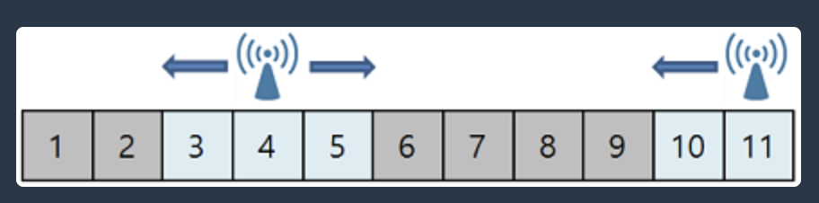
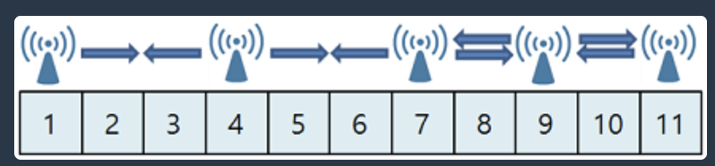
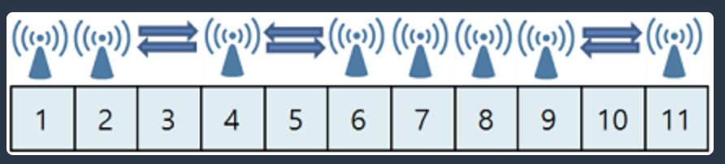
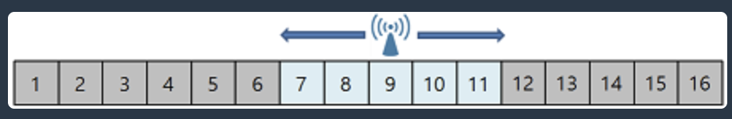
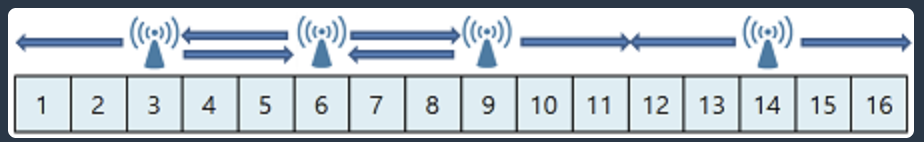

# 기지국 설치

## 문제 설명

`N`개의 아파트가 일렬로 쭉 늘어서 있습니다. 이 중에서 일부 아파트 옥상에는 4G 기지국이 설치되어 있습니다.

기술이 발전해 5G 수요가 높아져 4G 기지국을 5G 기지국으로 바꾸려 합니다. 그런데 5G 기지국은 4G 기지국보다 전달 범위가 좁아, 4G 기지국을 5G 기지국으로 바꾸면 어떤 아파트에는 전파가 도달하지 않습니다.

예를 들어 `11`개의 아파트가 쭉 늘어서 있고, `[4, 11]`번째 아파트 옥상에는 4G 기지국이 설치되어 있습니다.

만약 이 4G 기지국이 전파 도달 거리가 `1`인 5G 기지국으로 바뀔 경우 모든 아파트에 전파를 전달할 수 없습니다.

전파의 도달 거리가 `W`일 때, 기지국이 설치된 아파트를 기준으로 전파를 양쪽으로 `W`만큼 전달할 수 있습니다.

초기에 `1`, `2`, `6`, `7`, `8`, `9`번째 아파트에는 전파가 전달되지 않습니다.

`1`, `7`, `9`번째 아파트 옥상에 기지국을 설치할 경우, 모든 아파트에 전파를 전달할 수 있습니다.

더 많은 아파트 옥상에 기지국을 설치하면 모든 아파트에 전파를 전달할 수 있습니다.

이때, 우리는 5G 기지국을 최소로 설치하면서 모든 아파트에 전파를 전달하려고 합니다.

위의 예시에서는 최소 `3개`의 아파트 옥상에 기지국을 설치해야 모든 아파트에 전파를 전달할 수 있습니다.

아파트의 개수 `N`, 현재 기지국이 설치된 아파트의 번호가 담긴 1차원 배열 `stations`, 전파의 도달 거리 `W`가 매개변수로 주어질 때, 모든 아파트에 전파를 전달하기 위해 증설해야 할 기지국 개수의 최솟값을 return 하는 `solution` 함수를 완성해주세요.

## 제한사항

- `N`: `200,000,000` 이하의 자연수
- `stations`의 크기: `10,000` 이하의 자연수
- `stations`는 오름차순으로 정렬되어 있습니다.
- `stations`에 담긴 수는 `N`보다 작거나 같은 자연수입니다.
- `W`: `10,000` 이하의 자연수

## 입출력 예

| N | stations | W | answer |
| ---: | --- | ---: | ---: |
| 11 | `[4, 11]` | 1 | 3 |
| 16 | `[9]` | 2 | 3 |

## 입출력 예 설명

### 입출력 예 #1

문제의 예시와 같습니다.

따라서 모든 아파트에 전파를 전달하기 위해 최소 `3개`의 기지국을 추가로 설치해야 합니다.

### 입출력 예 #2

초기에 `1~6`, `12~16`번째 아파트에는 전파가 전달되지 않습니다.

`3`, `6`, `14`번째 아파트 옥상에 기지국을 설치할 경우 모든 아파트에 전파를 전달할 수 있습니다.

따라서 모든 아파트에 전파를 전달하기 위해 최소 `3개`의 기지국을 추가로 설치해야 합니다.
